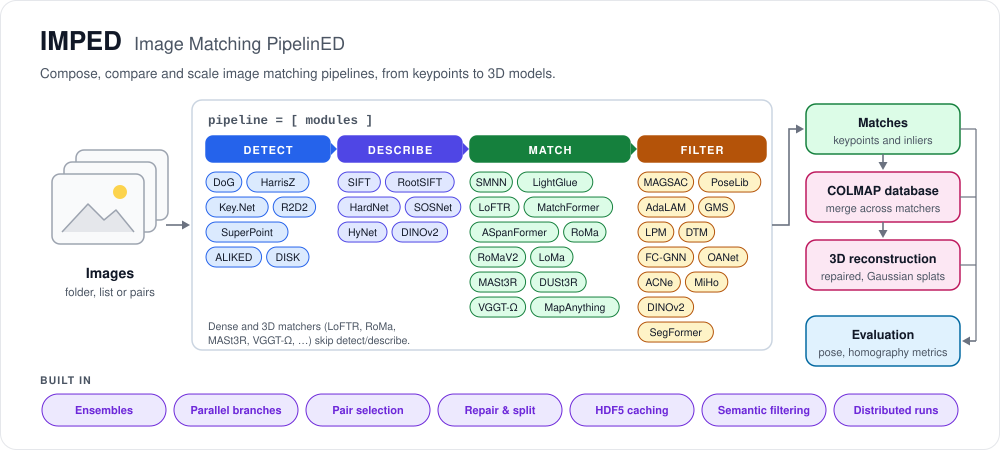
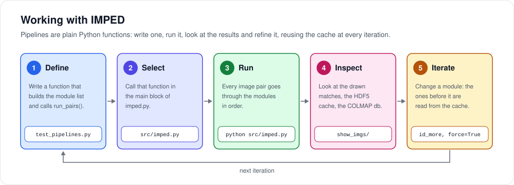
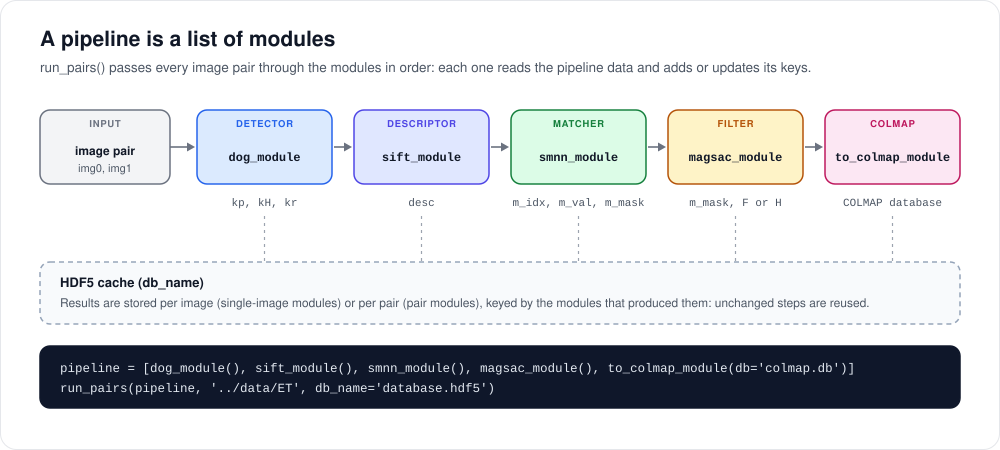
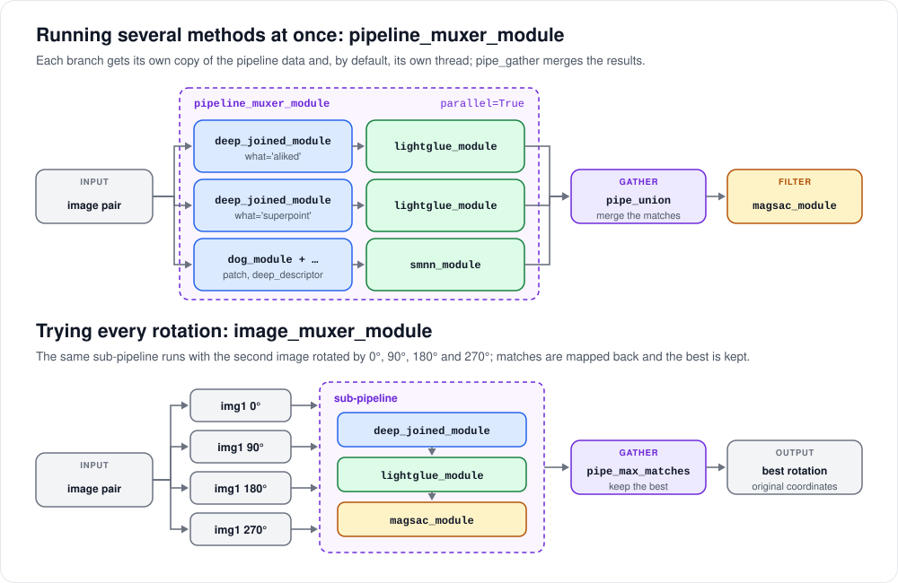
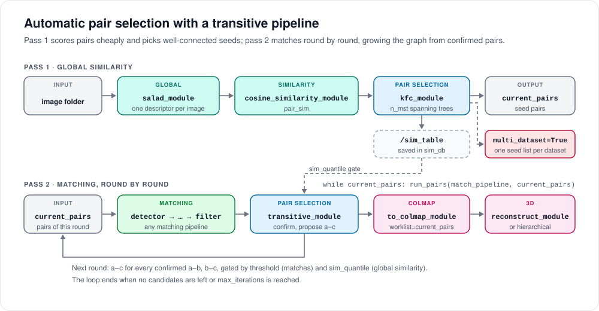
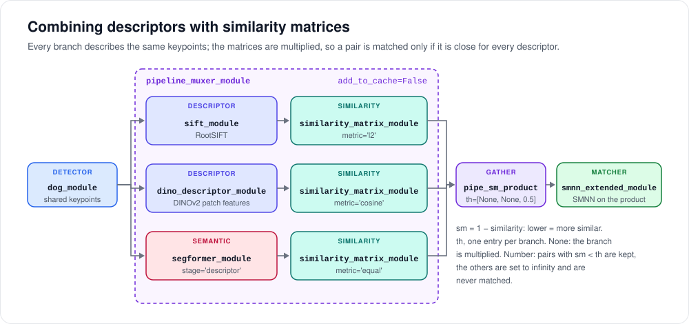

# IMPED (Image Matching PipelinED)

**IMPED** is a modular image matching and feature pipeline toolkit. It provides a unified, composable interface for building, testing, and benchmarking image matching pipelines, from keypoint detection and description to geometric filtering, COLMAP integration, and ensemble methods.



---

## Overview

IMPED is designed around a simple principle: a pipeline is a list of modules. Each module (detector, descriptor, matcher, filter, ensemble helper, or visualization tool) is a self-contained unit that can be freely combined, swapped, and benchmarked. This makes it easy to prototype new pipelines, reproduce existing methods, and evaluate combinations systematically.

Key features:
- **Modular by design**: mix and match detectors, descriptors, matchers, and filters in any combination.
- **Broad method coverage**: includes SIFT, R2D2, KeyNet, HardNet, LightGlue, LoFTR, LoMa, RoMa, MASt3R, DUSt3R, VGGT-Omega, MapAnything, MatchFormer, ASpanFormer, and more.
- **Semantic filtering**: SegFormer and DINOv2 can flag matches on unwanted content (an extra `m_mask` column).
- **Multi-descriptor matching**: per-keypoint descriptors of any kind (SIFT, DINOv2 features, semantic classes) are combined through their similarity matrices before nearest-neighbor matching.
- **Ensemble support**: union, muxing, pyramid, and sampling utilities for combining multiple pipelines.
- **COLMAP integration**: export/import features and matches, use COLMAP databases for pair selection, and merge reconstructions.
- **Benchmarking tools**: built-in support for MegaDepth-1500, ScanNet-1500, IMC PhotoTourism, and planar datasets with standard pose and homography metrics.
- **Incremental processing**: HDF5-backed caching avoids redundant computation across runs.
- **In-memory database cache**: reads and writes to the HDF5 database go through an in-memory cache and are flushed to disk in batches, so pipelines don't hit the disk on every entry.
- **Device-aware execution**: per-module CPU/GPU assignment with automatic tensor routing.
- **Automatic pair selection**: a transitive pipeline (`transitive.kfc_module` + `transitive.transitive_module`, driven by a plain `while` loop around `run_pairs()`) avoids exhaustive pairwise matching on large datasets by scoring pairs with a cheap global descriptor and growing the match graph transitively.
- **Live graph visualization**: watch pairs get confirmed round by round on an interactive graph view.
- **Incremental 3D reconstruction**: `reconstruct_module` runs COLMAP's incremental mapper once per round of a transitive pipeline, continuing from the previous round's model and reconstructing in the background while the next round matches; `hierarchical_reconstruct_module` also keeps disconnected sub-models and tries to merge them.
- **Multi-dataset pipelines**: `kfc_module(multi_dataset=True)` splits a mixed image set into separate datasets by cutting the global-similarity spanning tree, so the rest of the pipeline can run on, and reconstruct, each one independently.

For a quick tour of what is possible, browse `src/imped_tests/test_pipelines.py`; it contains many ready-to-run examples covering a wide range of pipeline combinations.

---

## Installation

Several methods are integrated as git submodules under `external/`, so clone the repository with them:

```bash
git clone --recursive <repository-url>
cd IMPED
# or, in an existing clone:
git submodule update --init --recursive
```

Then create the environment:

```bash
python -m venv imped
source imped/bin/activate
pip install -r src/requirements.txt
```

Model weights (DINOv2, SALAD, SegFormer, VGGT-Omega, MapAnything, ...) are downloaded automatically on first use.

---

## Usage

The main entry point is `src/imped.py`. The quickest way to get started is to point it to one of the predefined pipelines in `src/imped_tests/test_pipelines.py`, or define your own directly.

### Working with IMPED



1. **Define**: write a function in `src/imped_tests/test_pipelines.py` that builds the list of modules and calls `run_pairs()` (see the examples below).
2. **Select**: call that function in the `__main__` block of `src/imped.py`.
3. **Run**: run `python src/imped.py`; every image pair goes through the modules in order.
4. **Inspect**: drawn matches go to `show_imgs/` (`show_matches_module`), results to the HDF5 database given as `db_name`, and matches to the COLMAP database when the pipeline ends with `to_colmap_module`.
5. **Iterate**: change the pipeline and run it again.

**How the cache behaves across iterations.** Each result is stored under the image (single-image modules) or the pair (pair modules) and the chain of modules that produced it. Changing or adding a module therefore reuses everything computed by the modules before it. A module's identity does not include its parameters, though: after changing a parameter, give the module a new `id_more` (e.g. `smnn_module(th=0.9, id_more='th09')`) or call `run_pairs(..., force=True)`, otherwise the previous results are read back from the cache.

From a working prototype, the following sections cover the next steps: comparing pipelines with the benchmarking tools in `src/benchmark/`, scaling to large datasets with a [transitive pipeline](#automatic-pair-selection-with-a-transitive-pipeline), [3D reconstruction](#incremental-3d-reconstruction-with-reconstruct_module), and re-matching only the images a first reconstruction could not register.

### Running a predefined pipeline

Edit `src/imped.py` to select a pipeline:

```python
from imped_tests import test_pipelines

if __name__ == '__main__':
    with torch.inference_mode():
        test_pipelines.pipeline15()
```

Then run:

```bash
python src/imped.py
```

The example pipelines use paths relative to `src/` (e.g. `../data/ET`, `output_tests/`), so `imped.py` moves into `src/` when it starts and can be launched from any folder. `src/imped_tests/good_tests.py` runs the reference set of test pipelines in the same way (`python src/imped_tests/good_tests.py`).

### Defining a custom pipeline



`run_pairs()` passes every image pair through the modules in order: each module reads what the previous ones produced (keypoints `kp`, descriptors `desc`, matches `m_idx`, inlier mask `m_mask`, ...) and adds its own output. Single-image modules (detectors, descriptors) run once per image, pair modules (matchers, filters) once per pair, and both are cached.

A pipeline is a Python list of module instances. The following example runs a classic detect-describe-match-filter pipeline with match visualization:

```python

def custom_pipeline():
    pipeline = [
        dog_module(),
        patch_module(),
        deep_descriptor_module(),
        smnn_module(),
        magsac_module(),
        show_matches_module(
            id_more='only',
            img_prefix='matches_',
            mask_idx=[1, 0],
            prepend_pair=False,
        ),
    ]
    imgs = '../data/ET'
    run_pairs(pipeline, imgs, db_name='database_custom.hdf5')


if __name__ == '__main__':
    with torch.inference_mode():
        custom_pipeline()
```

### Advanced example: ensemble pipelines with COLMAP export

The following example showcases capabilities that go beyond what prior frameworks offered: rotation-robust matching via `image_muxer_module`, multi-pipeline fusion via `pipeline_muxer_module`, and incremental COLMAP export from independent runs that share a single database making it straightforward to merge results from different matchers in a subsequent reconstruction step.

`pipeline_a` fuses LoFTR and LightGlue (via `deep_joined_module`) under a `pipeline_muxer_module` that takes the union of their matches. That fused pipeline is then wrapped in an `image_muxer_module` with `pair_rot4`, which evaluates four 90° rotations of each image pair and keeps the orientation that yields the most matches, useful for datasets with high degree of rotations. Besides saving the computation in a HDF5 database, all results are exported to a shared COLMAP database.

`pipeline_b` runs RoMa independently saving data in another HDF5 database, but directly merging matches in the same COLMAP database of `pipeline_a`.

```python

def advanced_ensemble_pipeline():
    pipeline_a = [
        image_muxer_module(
            pair_generator=pair_rot4,
            pipe_gather=pipe_max_matches,
            pipeline=[
                pipeline_muxer_module(
                    pipe_gather=pipe_union,
                    pipeline=[
                        [
                            loftr_module(),
                            show_kpts_module(id_more='1st', img_prefix='a_', prepend_pair=False),
                        ],
                        [
                            deep_joined_module(),
                            show_kpts_module(id_more='2nd', img_prefix='b_', prepend_pair=False),
                            lightglue_module(),
                        ],
                    ],
                ),
                magsac_module(),
                show_matches_module(id_more='1st', img_prefix='union_matches_', mask_idx=[1, 0], prepend_pair=False),
            ],
        ),
        show_kpts_module(id_more='3th', img_prefix='union_', prepend_pair=False),
        show_matches_module(id_more='2nd', img_prefix='best_matches_', mask_idx=[1, 0], prepend_pair=False),
        to_colmap_module(db='custom_colmap_ab.db'),
    ]
    imgs = '../data/ET'
    run_pairs(pipeline_a, imgs, db_name='database_custom_a.hdf5')

    pipeline_b = [
        roma_module(),
        magsac_module(),
        show_matches_module(img_prefix='matches_', mask_idx=[1, 0], prepend_pair=False),
        to_colmap_module(db='custom_colmap_ab.db'),
    ]
    run_pairs(pipeline_b, imgs, db_name='database_custom_b.hdf5', colmap_db_or_list='custom_colmap_ab.db', mode='include')


if __name__ == '__main__':
    with torch.inference_mode():
        advanced_ensemble_pipeline()
```
This pipeline is already implemented in `src/imped_tests/test_pipelines.py` as `pipeline42()`.

### Module options

Each module exposes a number of configuration options; please refer to the source code of each module for the available arguments.

### Adding custom modules

Writing a new module is intentionally simple: implement the required interface and drop the file into the appropriate subdirectory. The module can then be composed into any pipeline just like a built-in one. Contributions and new integrations are welcome: feel free to open a pull request.

### Device control

Each module accepts an optional `device` argument. `run_pipeline()` detects the target device per module and routes tensors automatically, making it straightforward to mix CPU and GPU stages:

```python
pipeline = [
    loftr_module(device='cpu'),
    magsac_module(device='cuda'),
]
```

### Parallel sub-pipelines



`pipeline_muxer_module` runs its sub-pipelines in parallel by default, each one in its own thread, so their CPU work (image loading, Python code, OpenCV) overlaps. Their GPU kernels are queued on the same CUDA stream, so the results are exactly those of running the sub-pipelines one after the other. The sub-pipelines share the HDF5 database through a lock, each one gets its own copy of the pipeline data, and the inference/grad mode of the caller is carried over to every thread. Modules that draw with matplotlib and modules with shared class-level caches (`segformer_module`) serialize the critical part with a lock. Since the visualization modules only save figures to file, `core` sets matplotlib to the non-interactive `Agg` backend, which, unlike GUI backends such as TkAgg, works from any thread; to show figures interactively in your own scripts, call `matplotlib.use(...)` with a GUI backend after importing `core`.

Since every sub-pipeline is on the GPU at the same time, peak memory grows with the number of sub-pipelines; pass `parallel=False` to run them one after the other:

```python
pipeline_muxer_module(pipe_gather=pipe_union, parallel=False, pipeline=[...])
```

Each sub-pipeline must use its own module instances, as in every example in `src/imped_tests/test_pipelines.py`.

### `run_pairs()` options

| Argument | Description |
|---|---|
| `pipeline` | List of modules to execute |
| `imgs` | Directory path or list of image file paths |
| `db_name` | Output HDF5 database filename (default: `database.hdf5`) |
| `db_mode` | Database open mode, typically `'a'` to append |
| `force` | If `True`, rerun modules even when cached results exist |
| `add_path` | Prefix applied to image paths when passing relative pairs |
| `colmap_db_or_list` | Optional COLMAP database, COLMAP model folder, image list or pair list for pair selection |
| `colmap_has_pose` | With a COLMAP model folder: `True` selects the images registered in the model, `False` the ones that are not (default: `True`) |
| `mode` | Pairing mode for `image_pairs` (default: `'exclude'`) |
| `colmap_req` | Required COLMAP data type (default: `'geometry'`) |
| `colmap_min_matches` | Minimum match count for COLMAP-based pairing |

### Automatic pair selection with a transitive pipeline



For datasets too large to match exhaustively, a **transitive pipeline** builds the pair list for a real matching pipeline automatically: a cheap global-descriptor pass scores every candidate pair, `kfc_module` picks a well-connected seed set from that score table, and `transitive_module` grows the match graph transitively from there (if A-B and B-C are confirmed, A-C is tried next), so most of the dataset never needs to be scored pairwise.

Pass 1: global similarity, computed exhaustively but cheaply (one descriptor per image, or a downscaled SIFT pass):

```python
current_pairs = []
allowed = set()
global_db = 'database_global.hdf5'
global_pipeline = [
    salad_module(),
    cosine_similarity_module(),
    kfc_module(pairs=current_pairs, allowed=allowed, sim_quantile=0.75, sim_db=global_db, out_path='kfc_pairs.hdf5', n_mst=2),
]
run_pairs(global_pipeline, '../data/ET', db_name=global_db)
```

`kfc_module` (Keypoint Filtering by Coverage, Bellavia et al., 2022) selects the seed pairs as `n_mst` successive maximum spanning trees over the similarity graph. `current_pairs` is filled in place, so it's ready as soon as `run_pairs()` returns. The full similarity table is saved as a single `/sim_table` entry in `sim_db`. When given a set as `allowed`, `kfc_module` also fills it with the pairs whose similarity is at least `sim_min`, or at least the `sim_quantile` quantile (0..1) of the table when `sim_min` is not set; `sim_quantile` is scale-independent, so the same setting works whether pass 1 produced SIFT match counts or SALAD cosine similarities.

Pass 2: the real matching pipeline, driven round by round:

```python
transitive = transitive_module(pairs=current_pairs, allowed=allowed, threshold=0, max_iterations=10)
match_pipeline = [
    dog_module(), sift_module(), smnn_module(), magsac_module(),
    transitive,
    to_colmap_module(db='match.db', worklist=current_pairs),
]

while current_pairs:
    run_pairs(match_pipeline, current_pairs, db_name='database_match.hdf5')
```

`transitive` is placed in the pipeline like any other module. `current_pairs` is the exact same list object `kfc_module` filled, so the `while` condition and `transitive.pp` always agree. Each `run_pairs()` call runs one round over the current pair list; by the time it returns, `finalize_pipeline()` has already called `transitive.finalize()`, which drops the pairs just tried and appends the next round's transitive candidates (a-c for every confirmed a-b, b-c), gated by `threshold` (pass-2 match confirmation) and `allowed` (pass-1 similarity, to skip weak transitive candidates without ever matching them). The loop ends once the pair list is empty, either because there's nothing left to try or `max_iterations` was reached.

Modules placed after `transitive` can defer expensive teardown (closing a database, waiting for a reconstruction) until the closure is actually done, instead of doing it after every round. `to_colmap_module` and `reconstruct_module` take `worklist=current_pairs`, the same list, and only tear down once it is empty; `live_pair_graph` needs more than that (queued pairs, threshold, round numbers), so it takes `worklist=transitive` and reads `transitive.args['continue']`, which `transitive.finalize()` sets to whether another round is coming.

**Watching it live**: `live_pair_graph`, placed after `transitive` with `worklist=transitive`, renders the pair graph as an interactive HTML page (pyvis/vis.js), redrawn once per round (or every `redraw_every` confirmed pairs, for finer-grained feedback within a long round) rather than after every single pair. Confirmed edges are colored by which round confirmed them (`transitive.pair_round`): blue for the seed round, green for later transitive rounds; pending candidates show as dashed orange, rejected pairs as dashed red. See `pipeline52()`, `pipeline_ssma_transitive()` and `pipeline_ssma_transitive_salad()` in `src/imped_tests/test_pipelines.py` for complete examples.

### Global descriptors

A **global descriptor** is one embedding vector per image, computed once and reused for every pair that image is part of: the cheap alternative to matching keypoints between every pair directly. `salad_module` computes it with DINOv2-SALAD Izquierdo & Civera, "Optimal Transport Aggregation for Visual Place Recognition", adapted from [serizba/salad](https://github.com/serizba/salad): each image is resized to 322×322 and passed once through a DINOv2 backbone plus a SALAD aggregation head, giving a single embedding cached per image (`global_desc`), with no pair-specific computation at all.

Two pair-level modules turn a pair of global descriptors into a single `pair_sim` score: `cosine_similarity_module` (cosine similarity) and `l2_similarity_module` (negative L2 distance, so higher is still "more similar", same sign convention as the cosine version). Both are what feeds `kfc_module`/`conf_module` in a transitive pipeline (see above), and both cache their result per pair like any other module.

`n_matches_similarity_module` produces the same `pair_sim` output from a different source, the number of RANSAC inliers surviving a real (if downscaled) SIFT + MAGSAC pass, so it can be dropped into the same `kfc_module` pipeline as a similarity source when a real geometric check is affordable for the whole dataset, instead of a learned global descriptor. `pipeline_ssma_transitive` uses this variant; `pipeline_ssma_transitive_salad` and `full_pipeline_ssma` use SALAD's cosine similarity instead.

### Multi-dataset pipelines

When a folder mixes images of different scenes, `kfc_module(multi_dataset=True)` first splits the images into separate datasets and then runs the usual KFC seed selection on each one. `datasets`, passed by reference like `pairs`, is filled with one seed-pair list per dataset:

```python
datasets = []
global_pipeline = [
    salad_module(),
    cosine_similarity_module(),
    kfc_module(datasets=datasets, sim_db=global_db, out_path=None, multi_dataset=True),
]
run_pairs(global_pipeline, images_folder, db_name=global_db)

for i, current_pairs in enumerate(datasets):
    transitive = transitive_module(pairs=current_pairs, ...)
    match_pipeline = [..., transitive, to_colmap_module(db=f'dataset_{i}.db', worklist=current_pairs, ...), ...]
    while current_pairs:
        run_pairs(match_pipeline, current_pairs, db_name='match.hdf5')
```

The split (`kfc_module.split_datasets`) works on the maximum spanning tree of the similarity table:

1. Every tree edge is compared with its *neighbours*, the other tree edges touching its two endpoints. It becomes a candidate cut when its similarity is below `cut_ratio` times their mean, so the threshold adapts to how similar each block of images is.
2. Candidates are tried from the weakest. A cut is kept only if both sides have at least `min_dataset_size` images and the mean similarity *between* the two sides (over every pair in the table, not just tree edges) is below `sep_ratio` times the lower of the two within-side means, i.e. the two groups are really less similar to each other than to themselves.
3. The connected components of the cut tree are the datasets.

If the number of datasets is known, `n_datasets=N` replaces steps 1-2: tree edges are cut by increasing similarity relative to their neighbours (still honouring `min_dataset_size`) until there are `N` datasets. Every accepted cut is printed (`kfc_module: cut at similarity ... -> A / B images`), together with the final dataset sizes, which is the quickest way to tune `cut_ratio`/`sep_ratio` on new data.

Each dataset then gets its own `transitive_module`, COLMAP database and reconstruction; since seeds are chosen within a dataset and transitive candidates only grow from confirmed pairs, matching never crosses datasets. See `pipeline64()` in `src/imped_tests/test_pipelines.py`.

### Incremental 3D reconstruction with `reconstruct_module`

`reconstruct_module` runs COLMAP's incremental mapper (`pycolmap.incremental_mapping`) once per round of a transitive pipeline, continuing from the previous round's model instead of starting over: the first round reconstructs from scratch, every later round feeds the previous round's output back in as `input_path`, so newly confirmed matches (and pairs the mapper skipped the first time) extend the existing reconstruction rather than triggering a full rebuild. When COLMAP returns several disconnected sub-models, the one with the most registered images is kept.

Placed right after `to_colmap_module` (same `db`, so it always reads that round's committed matches) and given the same `worklist=current_pairs`, each round's reconstruction runs in a background thread while the next round's matching proceeds. `finalize()` only blocks when it needs to start a new round's reconstruction and the previous one hasn't finished yet, since it needs that output to continue from:

```python
match_pipeline = [
    dog_module(), sift_module(), smnn_module(), magsac_module(),
    transitive,
    to_colmap_module(db='match.db', worklist=current_pairs, no_unmatched=False),
    reconstruct_module(db='match.db', images='../data/ET', output='model', worklist=current_pairs),
]
```

`no_unmatched=False` is required on `to_colmap_module` in this setup: COLMAP refuses to continue from a previous model if an image's keypoint count in the database changed, and the default `no_unmatched=True` grows each image's keypoint set every time a new pair is matched. Storing every keypoint keeps the count fixed from the first round.

Without a `worklist`, it runs synchronously at the end of a single, non-transitive `run_pairs()` call, so the same module works for both kinds of pipeline.

**`hierarchical_reconstruct_module`** is a drop-in replacement that keeps every sub-model instead of only the largest one. Each round it continues every model kept so far, also reconstructs from scratch, and then tries to merge the candidates pairwise: two models sharing at least `overlap_threshold` of their images are treated as duplicates and the better one is kept; otherwise they are aligned (`pycolmap.align_reconstructions_via_points`), re-triangulated and bundle-adjusted, and the merge is rejected if it loses registered images or the reprojection error grows by more than `reproj_error_factor`. The remaining models are written to `output/0`, `output/1`, …; merged models are appended last, so the last one is usually the most complete.

**Recovering unregistered images**: a fast reconstruction can be followed by a more robust matcher run only where it's needed. `colmap_db_or_list` also accepts a COLMAP model folder (recognized by its `images.bin`/`images.txt`): with `colmap_db_or_list=fast_model, mode='include', colmap_has_pose=False`, `image_pairs` keeps just the pairs involving at least one image *not* registered in that model, so the second pass matches the unregistered images against everything else and exports into the same COLMAP database before reconstructing again. See `pipeline58()` (SuperPoint first, then rotation-robust RoMaV2 via `pair_rot4`).

### Semantic filtering with SegFormer and DINOv2

`segformer_module` and `dino_filter_module` never remove anything: they annotate matches, so the unfiltered data stays available to every later module. Both are placed after the matcher and append a column to `m_mask`:

| Module | A match is kept when |
|---|---|
| `segformer_module(stage='matches')` | neither end of the match lies on an excluded Cityscapes class (sky, people and vehicles by default, see `exclude_classes`) |
| `dino_filter_module` | the DINOv2 features at the two ends of the match have a cosine similarity of at least `sim_th` |

`dino_filter_module` uses `dinov2_vits14` patch features (resized to `resize`=518 px on the longest side). See `pipeline51()` and `pipeline61()` in `src/imped_tests/test_pipelines.py`.

### Combining descriptors with similarity matrices



Several descriptors of the *same* keypoints can be combined into a single matching decision, so that semantic information contributes to the choice of each match instead of only accepting or rejecting it afterwards:

1. `similarity_matrix_module(metric=...)` compares the descriptors `desc` of the two images and returns the [N0, N1] matrix `sm` as `1 - similarity`, i.e. as a distance, where lower means more similar:
   - `'cosine'`: 1 minus the cosine similarity (clamped at 0), in [0, 1];
   - `'l2'` / `'l1'`: the L2 / L1 distance;
   - `'equal'`: 0 where the descriptors are equal, 1 otherwise.
2. A `pipeline_muxer_module` runs one branch per descriptor (descriptor module followed by `similarity_matrix_module`), and `pipe_sm_product` combines the branch matrices by element-wise product, so a keypoint pair stays close only if it is close for every descriptor. A branch can also act as a pure filter: `pipe_gather=partial(pipe_sm_product, th=[None, None, 0.5])` gives one entry per branch. With `None` the branch enters the product as it is; with a number only the pairs with `sm` below it are kept, and the others are set to infinity.
3. `smnn_extended_module` runs the same Symmetric Mutual Nearest Neighbors matching as `smnn_module` on that matrix, instead of computing distances from `desc`. Pairs at infinity are never matched, whatever the ratio threshold.

```python
pipeline = [
    dog_module(),
    pipeline_muxer_module(pipe_gather=partial(pipe_sm_product, th=[None, None, 0.5]), add_to_cache=False, pipeline=[
        [sift_module(), similarity_matrix_module(metric='l2')],
        [dino_descriptor_module(), similarity_matrix_module(metric='cosine')],
        [segformer_module(stage='descriptor'), similarity_matrix_module(metric='equal')],
    ]),
    smnn_extended_module(),
    magsac_module(),
]
```

Any per-keypoint quantity can be used as a descriptor this way:

- `dino_descriptor_module` is a single-image descriptor module like `sift_module`: it gives each keypoint already detected the L2-normalized DINOv2 patch feature sampled at its position. It can also be used on its own with `smnn_module` (see `pipeline60()`): on normalized vectors the L2 distance ranks neighbors exactly like the cosine similarity.
- `segformer_module(stage='descriptor')` gives each keypoint its Cityscapes class id as a one-value descriptor. With `metric='equal'` its matrix is 0 for keypoints on the same class and 1 otherwise, so with a threshold such as 0.5 it removes every candidate match between different classes. Give `'equal'` a threshold, since its zeros would otherwise cancel the product, and leave at least one branch with `None`, since the kept pairs of thresholded branches all count the same.

The keypoints must be detected before the muxer, so that every branch describes the same ones and the matrices line up. `smnn_module` is unchanged. The matrices grow with the product of the two keypoint counts (8000 keypoints per image give 64M entries per pair), so `similarity_matrix_module` doesn't cache them and the muxer is created with `add_to_cache=False`; the per-image descriptors and the final matches are cached as usual. See `pipeline59()` and `pipeline65()` (the metrics and the matching alone, on synthetic descriptors) in `src/imped_tests/test_pipelines.py`.

### In-memory database cache

Every HDF5 database opened by `run_pairs()` goes through `pickled_hdf5` (`external/pickled_hdf5`), which keeps an in-memory cache in front of the file:

- **Writes** (`add`) are buffered in memory and written to disk in a single batch once the cache holds `cache_size` entries (default `1000`), or when the database is closed. Removals (`remove`) are deferred the same way.
- **Reads** (`get`) keep the loaded entry in memory, so reading the same entry again doesn't touch the disk.
- **Isolation**: entries are kept in memory in their serialized form, and every `get` returns a fresh copy, so modifying the returned object never alters what is cached or later written to disk.
- **Consistency**: `get`, `contain` and `get_keys` all take the cache into account: an entry that was just added but not yet flushed is already visible, and one that was removed is already hidden.
- **HDF5 chunk cache**: the underlying `h5py` file is also opened with a larger chunk cache (`rdcc_nbytes`, default 64 MB).
- **What is kept in memory**: `add` and `get` take a `force_no_cache` flag that bypasses the in-memory cache, writing straight to the file and reading without caching. A module opts in by setting `self.force_no_cache = True` (or `force_no_cache=True` in its constructor); it defaults to `False`, and it is independent of `add_to_cache`, which decides whether the result is stored in the file at all. The pair similarity modules (`cosine_similarity_module`, `l2_similarity_module`, `n_matches_similarity_module`) set it, since each pair's score is used once: with `salad_module` and `cosine_similarity_module` the SALAD descriptors, read again for every pair an image is part of, stay in memory while each pair's similarity goes straight to the file.

`cache_size=0` disables the buffering: every write goes to disk immediately. Since buffered entries only reach the disk on a flush, a run killed before `run_pairs()` closes its database loses at most the last `cache_size` uncommitted entries, which are simply recomputed on the next run. See `pipeline62()` in `src/imped_tests/test_pipelines.py`.

### Matching with 3D foundation models: VGGT-Omega and MapAnything

`vggt_omega_module` ([VGGT-Omega](https://huggingface.co/facebook/VGGT-Omega)) and `mapanything_module` ([MapAnything](https://huggingface.co/facebook/map-anything)) don't match descriptors: they predict depth and camera poses for the two images in one forward pass and derive the matches from that geometry.

1. A grid of pixels (one every `stride` pixels) of the first image is back-projected to 3D with the predicted depth and pose.
2. Each point is projected into the second image; points falling outside it or behind the camera are dropped.
3. A match is kept only if the projected depth agrees with the depth predicted for the second image within `depth_tol` (relative), which removes occluded points.
4. Matches are scored by the geometric mean of the two confidences, the best `max_keypoints` are kept, and their coordinates are mapped back to the original image resolution.

Their output (`kp`, `kH`, `kr`, `m_idx`, `m_val`, `m_mask`) is the same as any other matcher's, so they can be followed by `magsac_module`, `to_colmap_module` or used inside a `pipeline_muxer_module`. Both models live in the `external/vggt-omega` and `external/map-anything` submodules and download their weights from Hugging Face on first use. See `pipeline55()` and `pipeline56()` in `src/imped_tests/test_pipelines.py`.

### Distributed / multi-machine processing

Split the image set across machines with `split_images(imgs, n_chunks, chunk_idx)`: it divides the images themselves into `n_chunks` disjoint groups; run each group through `run_pairs()` independently (each worker only ever sees pairs within its own group), copying the same script and images to each machine and giving every worker its own `chunk_idx`, then merge the resulting per-worker HDF5 databases afterwards with `merge_hdf5([db_chunk0, db_chunk1, ...], merged_db)`.

See `pipeline44()` in `src/imped_tests/test_pipelines.py` for a worked example of the split/merge path.

---

## Module Reference

### Detectors
`dog_module` · `hz_module` · `r2d2_module` · `keynet_module`

### Descriptors
`patch_module` · `deep_descriptor_module` · `sift_module` · `dino_descriptor_module`

### Matchers
`smnn_module` · `smnn_extended_module` · `similarity_matrix_module` · `lightglue_module` · `loftr_module` · `roma_module` ·  `romav2_module` ·  `loma_module` · `vggt_omega_module` · `mapanything_module` · `mast3r_module` · `dust3r_module` · `matchformer_module` · `aspanformer_module`

### Filters
`magsac_module` · `poselib_module` · `adalam_module` · `gms_module` · `lpm_module` · `dtm_module` · `fcgnn_module` · `oanet_module` · `acne_module` · `mop_miho_ncc_module` · `dino_filter_module`

### Segmentation
`segformer_module`: SegFormer semantic segmentation (Cityscapes labels), flags matches falling on specific classes or gives each keypoint its class as a descriptor

### Ensemble
`image_muxer_module` · `pipeline_muxer_module` · `pipe_union` · `pipe_max_matches` · `pipe_sm_product` · `pipe_identity` · `pair_rot4` · `pair_pyramid` · `sampling_module`

### Global Descriptors & Similarity
`salad_module` · `cosine_similarity_module` · `l2_similarity_module` · `n_matches_similarity_module`

### Pair Selection
`conf_module` · `transitive.kfc_module` · `transitive.transitive_module`

### Visualization
`show_kpts_module` · `show_matches_module` · `show_patches_module` · `show_homography_module` · `live_pair_graph` 

### COLMAP
`to_colmap_module` · `from_colmap_module` · `merge_colmap_db` · `filter_colmap_reconstruction` · `align_colmap_models`

### 3D Reconstruction
`reconstruct.reconstruct_module` · `reconstruct.hierarchical_reconstruct_module`

---

## Repository Structure

```
src/
├── core/
│   ├── device.py              # Device setup, global flags
│   ├── pipeline.py            # run_pipeline, run_pairs, finalize_pipeline
│   ├── image_pairs.py         # image_pairs iterator
│   ├── geometry.py            # Homography and LAF utilities
│   └── utils.py               # Argument handling, serialization, math utils
│
├── detectors/
│   ├── dog_module.py
│   ├── keynet_module.py
│   ├── hz_module.py
│   └── r2d2_module.py
│
├── descriptors/
│   ├── patch_module.py
│   ├── deep_descriptor.py
│   ├── dino_descriptor_module.py
│   └── sift_module.py
│
├── matchers/
│   ├── smnn_module.py
│   ├── smnn_extended_module.py
│   ├── similarity_matrix_module.py
│   ├── lightglue_module.py
│   ├── loftr_module.py
│   ├── roma_module.py
│   ├── romav2_module.py
│   ├── loma_module.py
│   ├── vggt_omega_module.py
│   ├── mapanything_module.py
│   ├── mast3r_module.py
│   ├── dust3r_module.py
│   ├── matchformer_module.py
│   ├── aspanformer_module.py
│   ├── quadtreeattention.py
│   └── blob_matching.py
│
├── filters/
│   ├── magsac_module.py
│   ├── poselib_module.py
│   ├── lpm_module.py
│   ├── gms_module.py
│   ├── adalam_module.py
│   ├── fcgnn_module.py
│   ├── oanet_module.py
│   ├── acne_module.py
│   ├── dtm_module.py
│   ├── mop_miho_ncc_module.py
│   └── dino_filter_module.py      # DINOv2 feature-consistency match filter
│
├── segmentators/
│   └── segformer_module.py
│
├── ensemble/
│   ├── sampling.py
│   ├── muxers.py
│   └── pyramid.py
│
├── global_descriptors/
│   └── salad_module.py
│
├── similarity/
│   ├── cosine_similarity_module.py
│   ├── l2_similarity_module.py
│   └── n_matches_similarity_module.py
│
├── confidence/
│   └── conf_module.py
│
├── transitive/
│   ├── kfc_module.py           # Keypoint Filtering by Coverage (Bellavia et al., 2022), seed pair selection
│   └── transitive_module.py    # round-by-round transitive-closure driver
│
├── colmap_fun/
│   ├── colmap_ext.py
│   ├── to_colmap_module.py
│   ├── from_colmap_module.py
│   └── merge_colmap.py
│
├── reconstruct/
│   ├── reconstruct_module.py   # incremental COLMAP reconstruction, round by round
│   └── hierarchical_reconstruct_module.py   # keeps and merges disconnected sub-models
│
├── benchmark/
│   ├── datasets.py            # MegaDepth, ScanNet, IMC, planar dataset setup
│   ├── metrics.py             # Pose error, AUC, epipolar/homography metrics
│   └── benchmark_module.py    # Pairwise benchmark runner
│
├── visualization/
│   ├── show_kpts.py
│   ├── show_matches.py
│   ├── show_homography.py
│   ├── show_patches.py
│   ├── colorize.py
│   └── live_pair_graph.py     # interactive live pair-graph viewer
│
├── imc/
│   ├── imc.py                 # IMC 2025 ground truth generation and evaluation
│   ├── imc_other.py
│   └── imc_split.py
│
├── imped_tests/
│   ├── test_pipelines.py      # ready-to-run example and test pipelines
│   └── good_tests.py          # runs the reference set of test pipelines
│
└── imped.py                   # main entry point
```

Third-party code lives outside `src/`, in `external/`: the integrated methods are git submodules (`external/<name>`), while `external/modified/` holds third-party code adapted for IMPED and maintained in this repository: ACNe (`acne`), OANet (`oanet`), the LightGlue plotting helpers (`plot`) and the COLMAP database script (`colmap_db`). Both `external/` and `external/modified/` are added to the Python path by `src/imped.py` and by the test scripts.

---

## Notes

- `src/imped_tests/test_pipelines.py` contains many complete working examples. It is the recommended starting point for understanding how pipelines are composed.
- Ensemble utilities (`pipe_union`, `sampling_module`, `image_muxer_module`, `pipeline_muxer_module`) are useful for combining outputs from multiple sub-pipelines, deduplicating matches, and consolidating results.
- COLMAP integration supports exporting features and matches, importing COLMAP keypoints back into the pipeline, using COLMAP databases for pair selection, and merging results across computation paths.
- The `imgs` argument to `run_pairs()` accepts either a directory path or an explicit list of image paths.
- Results are cached in HDF5 format; set `force=True` to reprocess from scratch.
- `run_pairs()` is fully generic: it has no special handling for transitive pipelines, `live_pair_graph`, or `reconstruct_module`: it just runs `pipeline` once over the given pairs and calls `finalize_pipeline(pipeline)`. All the round-by-round behaviour lives in the modules themselves (`transitive_module.finalize()`) and in the `while` loop the caller writes around `run_pairs()`.
- `segformer_module` and `dino_filter_module` never remove matches; they only annotate them (an extra column on `m_mask`), so the original, unfiltered data stays available to any module placed after them.

---

## Roadmap

- [ ] Delete & refactor repeated code across modules
- [ ] Optimize HDF5 database read/write performance
- [ ] Improve documentation
- [ ] Add support for triplet or more images matching
